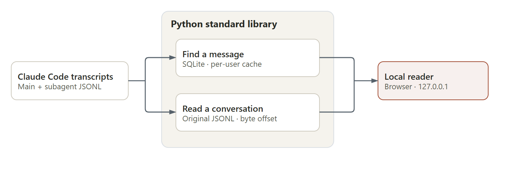

[English](README.md) · [简体中文](README.zh-CN.md)

# Claude Code Session Reader

Find an old Claude Code conversation by a detail you remember, read the exchange in context, and give your next agent the exact message.

## Why I built this

I use Claude Code in the terminal and in VS Code. Weeks later I might remember a model name or something Claude said, but rarely the session title. I used to open my `.claude` directory in VS Code, search across JSONL files, and untangle the matching line. Sometimes I just asked another agent to find the conversation for me.

There are a few good ways back into a conversation. Which one I'd reach for depends on what I want to do next.

| What I want to do | Where I'd start |
| --- | --- |
| Pick up yesterday's conversation in Claude Code | Preview the session in the built-in picker and resume it. [Claude Code `/resume`](https://code.claude.com/docs/en/sessions#use-the-session-picker) |
| Search Claude Code and Codex history from the terminal, or let an agent do the lookup | Search both histories interactively, or give the agent the `agent search` and `agent read` commands. [claude-history](https://github.com/raine/claude-history) |
| Find an error buried in a tool result | Search tool inputs and outputs in the browser, filter by tool, or let an agent query the same index over MCP. [Claude Code Chat Explorer](https://github.com/drewburchfield/claude-code-chat-explorer) |

I built this reader for the times when a new task needs *one message* from an old conversation. In the demo, two messages mention `Parakeet`. The subagent traces a callback. Claude's reply answers my question about which model finalizes the caption. I want to read the turns around each match and choose the right one, even after compaction if the original is still on disk. Then I can paste the answer and its file location into Codex and ask, “Does the code still follow this split?”

## Quick start

Download or clone the repository and open its folder. You’ll need **Python 3.9+** and a browser.

| Platform | Launch |
| --- | --- |
| Windows | Double-click **Open Reader.cmd**, or run `py -3 reader.py` |
| macOS / Linux | Run `python3 reader.py` |

The reader opens in your browser. Choose **简体中文** in the project sidebar to switch languages. The reader remembers your choice.

**Prefer to ask your agent?** Paste this with the repository open.

> Start Claude Code Session Reader on this computer using the README, find my local Claude Code sessions, and give me the browser link.

**Try it without a history.** Add `--demo` to the launch command. In **Search all sessions**, type `Parakeet`, open the main conversation's match, and click **Copy reference**.

I haven't tried the full workflow with real Claude Code sessions on macOS or Linux yet, so please open an issue or send a fix if you run into trouble.

## Finding a conversation

- **Remember a model, API, or field?** Search across projects or within one project. Results include the original words from user, Claude, and subagent messages. Select a snippet to jump to it.
- **Need the reasoning around it?** Read the surrounding turns. Expand **Activity** for recorded thinking, tool inputs, and results, or choose a subagent from the conversation menu.
- **Need the whole session?** **Copy ID** gives a local agent the session ID. **Copy reference** includes the transcript path, byte offset, content block, speaker, and an excerpt. A local agent with file access can go straight to it.

## How it works

The Python server reads `~/.claude/projects/` or the `projects/` directory under `CLAUDE_CONFIG_DIR`. It leaves transcripts untouched and keeps its SQLite index in your OS user cache. The interface and its Markdown renderer are bundled. Everything runs on `127.0.0.1`.

Use `--serve` to print the URL without opening a browser, or `--port 48800` to choose another port.

[MIT license](LICENSE) · [Bundled markdown-it license](markdown-it.LICENSE)
