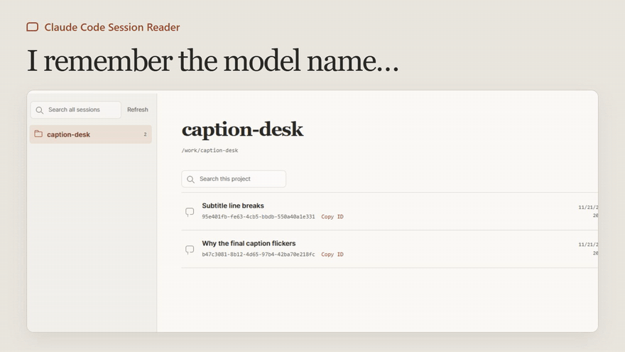

[English](README.md) | [简体中文](README.zh-CN.md)

# Claude Code Session Reader

Find an old Claude Code conversation by a few words you remember, read the exchange in context, and give your next agent the exact message.

[](media/session-reader.mp4)

## Why I built this

I use Claude Code in the terminal and in VS Code, and my history has grown to about 4.5 GB of transcripts from 37 projects. Weeks later I can often remember a model name, sometimes even half a sentence Claude wrote, but rarely which session it came from. I used to open my whole `.claude` directory in VS Code and search the JSONL files. Sometimes I'd ask Codex to look for me. Even with the right word on screen, I still had a question. Was this an option we'd considered, or what we'd actually decided to do?

| Existing option | What it finds | What's still missing for me |
| --- | --- | --- |
| Claude Code's `/resume` | I can preview an old session and pick up where I left off. | Once a message has been summarized, resuming gives Claude the summary. To see the original wording, I still need the transcript on disk. [What a resumed session restores](https://code.claude.com/docs/en/sessions#what-a-resumed-session-restores) |
| Searching JSONL in VS Code | One search across projects takes me straight to the matching line. | A question and its answer can sit several tool calls apart. I have to sort my follow-ups from tool output to read the exchange. |
| [claude-history](https://github.com/raine/claude-history) | I can find a message in the terminal and press `y` to copy it. | That puts the raw Markdown on my clipboard. The file path and session ID have separate copy commands, so I still have to assemble the quote and its source for Codex. [Viewer shortcuts](https://github.com/raine/claude-history#keyboard-navigation-viewer-mode) |
| [Omnilogue](https://github.com/jhlee0409/omnilogue) | A desktop app that searches sessions from Claude Code, Codex and many other assistants, and opens a hit at that message. | A message's copy button gives me its text. The session ID and file path are in the session's menu, so I still put the quote and its source together myself. |
| [Claude Code Chat Explorer](https://github.com/drewburchfield/claude-code-chat-explorer) | I can search messages and tool output in the browser. An agent can find matching excerpts over MCP, too. | The browser exports a whole conversation, and an MCP result links to the conversation transcript. I still have to point the next agent to the particular message I picked. [Conversation viewer and MCP search](https://github.com/drewburchfield/claude-code-chat-explorer#conversation-viewer) |

That's why there's a **Copy reference** button beside each matching passage. In the demo, `Parakeet` turns up in four messages across two projects: a lecture transcription test, an oversized installer, a subagent tracing a callback, and the conversation where Claude answers my question about which model finalizes a caption. I open that last one, read my question and the reply together, then copy the message with its speaker, transcript path and line number. All I need to add when I paste it into Codex is “Does the code still follow this split?”

## Quick start

You need **Python 3.9+** and a browser. There's nothing else to install.

```sh
git clone https://github.com/narmi924/claude-session-reader.git
cd claude-session-reader
python3 reader.py
```

On Windows, run `py -3 reader.py` or double-click **Open Reader.cmd**. The reader opens in your browser. Choose **简体中文** in the project sidebar to switch languages, and the reader remembers your choice.

**Prefer to ask your agent?** Paste this:

> Clone https://github.com/narmi924/claude-session-reader, start the reader as its README describes, and give me the link it prints.

**Try it without your own history.** Add `--demo` to the launch command. The demo uses its own port and search index, so you can keep your personal reader open. In **Search all sessions**, type `Parakeet`, open the match in “Why the final caption flickers”, and click **Copy reference**.

**Keep older sessions.** Claude Code deletes transcripts after 30 days by default. To keep more of them searchable, set `"cleanupPeriodDays": 365` or longer in `~/.claude/settings.json`. [Where transcripts are stored](https://code.claude.com/docs/en/sessions#where-transcripts-are-stored)

**On a remote machine**, run `python3 reader.py --serve` there, forward the port from your computer, and open the link it printed.

```sh
ssh -L 48763:127.0.0.1:48763 you@server
```

I haven't tried the full workflow with real Claude Code sessions on macOS or Linux yet, so please open an issue or send a fix if you run into trouble.

## Finding a conversation

- **Remember a few words?** Search across projects or within one project. A message matches when it contains all of the words, in any order. Results show the original words from you, Claude and subagents. Select a snippet to jump to it.
- **Need the reasoning around it?** Read the surrounding turns. Expand **Activity** for recorded thinking, tool inputs and results, or choose a subagent from the conversation menu.
- **Handing it to another agent?** **Copy ID** gives a local agent the session ID. **Copy reference** adds the transcript path, line number, speaker and the message itself, so an agent with file access can go straight to it.

## How it works


The Python server reads `~/.claude/projects/` or the `projects/` directory under `CLAUDE_CONFIG_DIR`, and never changes your transcripts. On my 4.5 GB history, the first index takes about 20 seconds and a search takes about a tenth of a second.

The search index and the reader's key are kept in your user cache: `%LOCALAPPDATA%\claude-session-reader` on Windows, `~/Library/Caches/claude-session-reader` on macOS and `~/.cache/claude-session-reader` on Linux. Delete that folder to remove them. The reader builds a new index the next time it starts.

The server listens only on `127.0.0.1`, and the browser gets in through the link with the key. Other accounts on a shared machine can't read your sessions.

Use `--serve` to print the link without opening a browser, or `--port 48800` to choose another port.

Released under the [MIT license](LICENSE). The bundled Markdown renderer keeps [its own license](markdown-it.LICENSE).
