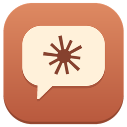
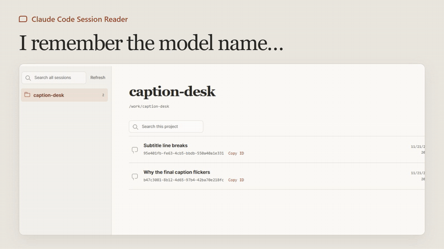
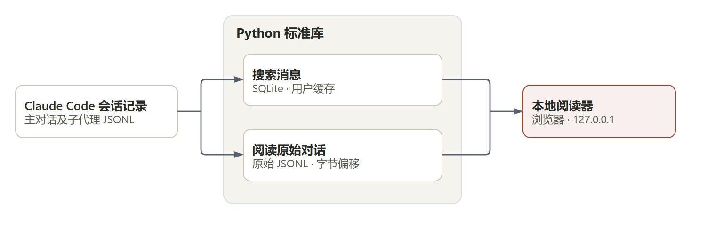

<p align="center"></p>

<h1 align="center">Claude Code 会话阅读器</h1>

<p align="center">凭记得的几个词找回旧对话，看清当时怎么问、怎么答，再把那条原话交给下一个 agent。</p>

<p align="center"><a href="README.md">English</a> | <a href="README.zh-CN.md">简体中文</a></p>

[](media/session-reader.mp4)

## 我为什么做这个工具

我平时在终端和 VS Code 里用 Claude Code，会话记录已经攒到 37 个项目、约 4.5 GB。隔几个星期，我往往还记得一个模型名，甚至记得 Claude 说过半句话，却忘了是哪次会话。以前我会在 VS Code 里打开整个 `.claude` 目录搜 JSONL，有时干脆让 Codex 帮我找。可我搜到那个词，还是想往上翻几句。我们只是提过这个选项，还是当时真的决定这么做了？

| 现有办法 | 能帮我找到什么 | 还缺哪一步 |
| --- | --- | --- |
| Claude Code 的 `/resume` | 预览旧会话，回去接着聊。 | 恢复会话时，已经压进摘要的消息不会逐条载入。想核对摘要之前的原话，还得翻磁盘上的记录。[会话恢复说明](https://code.claude.com/docs/en/sessions#what-a-resumed-session-restores) |
| 在 VS Code 里搜 JSONL | 在所有项目里搜一个词，直接打开命中那一行。 | 两句话中间可能隔着好几条工具调用。我得自己辨认哪些是我的追问、哪些是工具输出，才能把问答读连贯。 |
| [claude-history](https://github.com/raine/claude-history) | 在终端搜到消息，按 `y` 就能复制那条原文。 | 这次复制拿到的是 Markdown 正文。文件路径和会话 ID 各有一个复制键，想把原话和出处一起给 Codex，还得自己拼。[查看器快捷键](https://github.com/raine/claude-history#keyboard-navigation-viewer-mode) |
| [Omnilogue](https://github.com/jhlee0409/omnilogue) | 桌面应用，能搜 Claude Code、Codex 和很多其他助手的会话，点开命中会停在那条消息。 | 消息上的复制按钮只给正文。会话 ID 和文件路径在会话菜单里，原话和出处还得我自己拼到一起。 |
| [Claude Code Chat Explorer](https://github.com/drewburchfield/claude-code-chat-explorer) | 在浏览器里搜消息和工具输出，也能让 agent 通过 MCP 搜到摘录。 | 网页导出的是整段会话，MCP 结果里的资源链接也指向整段记录。我还得标出要让另一个 agent 读的是哪一句。[导出和 MCP 搜索](https://github.com/drewburchfield/claude-code-chat-explorer#conversation-viewer) |

所以我把「复制引用」放在了搜到的每段原文旁边。上面的视频里搜 `Parakeet` 会在两个项目里找到四条消息：一次讲课录音的转写测试，一个过大的安装包，一个追踪回调的子代理，还有 Claude 回答我「最后由哪个模型定稿」的那次对话。点开最后这条，能连着读到我的问题和 Claude 的回答。复制引用，原话、说话人、记录文件和行号就一起进了剪贴板。我把它贴给 Codex，接着问「现在的代码还按这个分工跑吗？」

## 快速开始

需要 **Python 3.9+** 和浏览器。克隆仓库后，打开对应系统的启动入口。

```sh
git clone https://github.com/narmi924/claude-session-reader.git
cd claude-session-reader
```

- **Windows** — 双击 `launch/` 中的 **Open Reader.pyw**。如果已有指向旧 `.cmd` 的快捷方式，将它改为指向这个文件。
- **macOS** — 双击 `launch/` 中的 **Open Reader.app**，将它留在仓库目录里。
- **Linux** — 运行一次 `python3 launch/install-linux.py`，之后从应用菜单打开 **Claude Code 会话阅读器**。

启动后会在默认浏览器打开本机会话。关闭最后一个阅读器标签页，服务会在几秒后自动退出。在侧栏选择 **简体中文** 即可切换语言。

也可以在终端运行 `python3 reader.py`（Windows 用 `py -3 reader.py`），或者让 agent 帮你启动：

> 把 https://github.com/narmi924/claude-session-reader 克隆到本机，启动阅读器并打开我的本地会话。

**留住更早的会话。** Claude Code 默认只保留 30 天的会话记录。想让更早的会话也能搜到，在 `~/.claude/settings.json` 里设置 `"cleanupPeriodDays": 365` 或更长。[会话记录存放说明](https://code.claude.com/docs/en/sessions#where-transcripts-are-stored)

**会话在远程机器上时**，在那台机器上运行 `python3 reader.py --serve`，从自己的电脑转发端口，再打开它打印的链接。

```sh
ssh -L 48763:127.0.0.1:48763 you@server
```

macOS 和 Linux 上的真实 Claude Code 会话还没完整试过，遇到问题欢迎提 issue，也欢迎直接发 PR 修复。

## 怎么找回一段对话

- **记得几个词。** 可以搜所有项目，也可以只搜一个项目。一条消息包含全部这些词就算命中，顺序不限。结果会列出你、Claude 和子代理说过的原话，点一条就跳到当时的位置。
- **想看为什么这么答。** 上下翻看前后几轮。展开「操作过程」可以看到记录里保存的思考、工具参数和返回结果，也可以从对话菜单切到子代理。
- **想交给另一个 agent。** 「复制 ID」给出会话 ID。「复制引用」还会带上记录文件、行号、说话人和原话，本地 agent 有文件访问权限就能直接找到那一句。

## 工作原理



Python 服务读取 `~/.claude/projects/`。设置了 `CLAUDE_CONFIG_DIR` 时，会读取该目录下的 `projects/`。它不会改动你的会话记录。在我 4.5 GB 的记录上，第一次建索引约 20 秒，之后每次搜索约 0.1 秒。

搜索索引和阅读器的访问密钥放在当前用户的缓存目录：Windows 是 `%LOCALAPPDATA%\claude-session-reader`，macOS 是 `~/Library/Caches/claude-session-reader`，Linux 是 `~/.cache/claude-session-reader`。删掉这个文件夹就清掉了，下次启动会重新建索引。

服务只监听 `127.0.0.1`，浏览器要通过带密钥的链接进入。多人共用一台机器时，其他账号读不到你的会话。

在终端加上 `--serve` 可以只打印链接，加上 `--port 48800` 可以指定端口。

本项目采用 [MIT 许可证](LICENSE)。内置的 Markdown 渲染器保留[它自己的许可证](markdown-it.LICENSE)。
